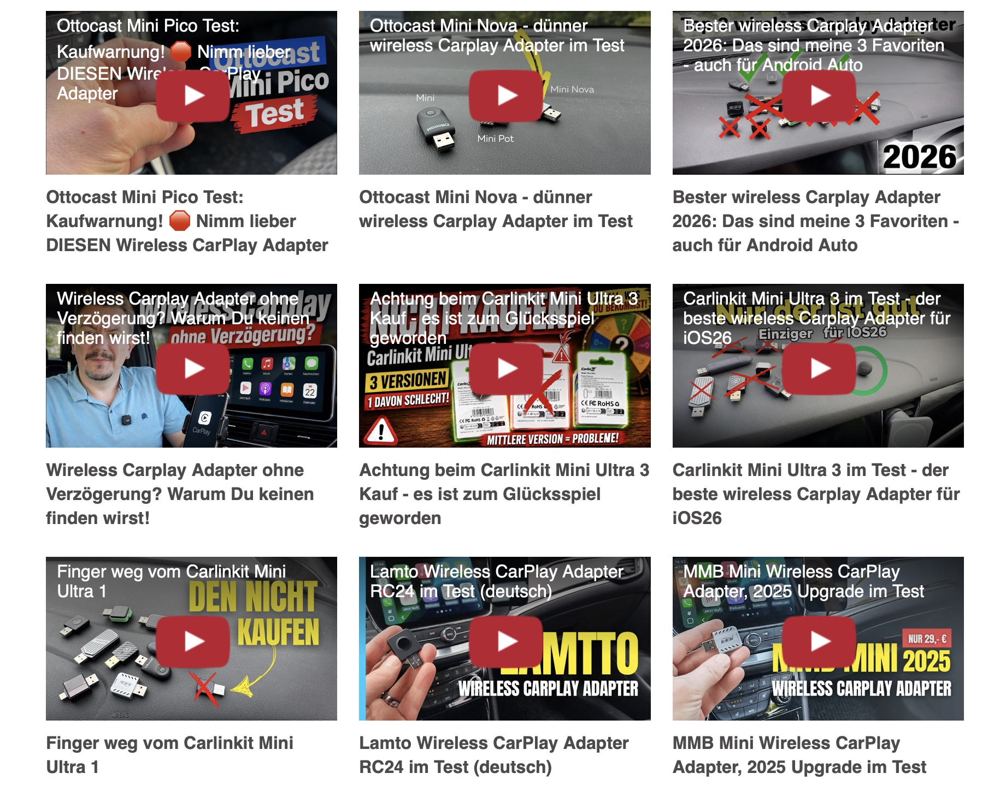

# LYTE Playlist Grid

A lightweight WordPress add-on for **[WP YouTube Lyte](https://wordpress.org/plugins/wp-youtube-lyte/)**. Display all publicly accessible videos from a YouTube playlist in a responsive grid. Each video is rendered by your existing LYTE player; the add-on does not introduce another YouTube player.

> An independent community extension. Not affiliated with YouTube, Google, or the developers of WP YouTube Lyte.



Step-by-step guide (German), including the YouTube API key setup: [YouTube Playlist in WordPress einbinden](https://mizine.de/html/youtube-playlist-wordpress-einbinden/). See it live on [mizine.de](https://mizine.de/getestete-wireless-carplay-adapter/).

## What it does

- Fetches a **public YouTube playlist** through the YouTube Data API v3.
- Automatically reflects playlist changes when its **12-hour WordPress cache** expires and the page is next requested.
- Provides **one LYTE thumbnail/player per unique video**, with its title below.
- Defaults to **3 columns** on desktops, 2 on tablets, and 1 on phones. Configurable 1–4 desktop columns.
- Loads this add-on's CSS only when the shortcode is used; preserves other LYTE players' styling.
- Reuses the API key configured in WP YouTube Lyte (including its `lyte_filter_yt_api_key` filter).
- Handles paginated playlists (up to 1,000 source entries), skips private/deleted placeholders and repeated video IDs.
- Keeps the latest successful playlist as a fallback during temporary API outages.
- Shows diagnostic errors to administrators only; visitors do not see API error details.
- German translation included.

## Requirements

- WordPress 6.0+ and PHP 7.4+
- Active **WP YouTube Lyte** plugin
- A valid **YouTube Data API v3** key in WP YouTube Lyte settings, permitted to call `playlistItems.list` from your server
- A publicly accessible playlist

API quota and any restrictions on your key are governed by Google. An HTTP-referrer-only API key may fail on server-side requests; configure applicable restrictions for the server instead.

## Installation

1. Install and activate [WP YouTube Lyte](https://wordpress.org/plugins/wp-youtube-lyte/), then configure its YouTube Data API v3 key.
2. In WordPress, choose **Plugins → Add New → Upload Plugin** and upload the distributable ZIP from [Releases](../../releases).
3. Activate **LYTE Playlist Grid**.
4. Add a **Shortcode** block to a page:

   ```text
   [lyte_playlist_grid id="PL-DHsM-Gc8c9rWf4gqzhkBbdwtpuDLOaB"]
   ```

   For four desktop columns:

   ```text
   [lyte_playlist_grid id="PL-DHsM-Gc8c9rWf4gqzhkBbdwtpuDLOaB" columns="4"]
   ```

This is the playlist ID after `list=` in the YouTube playlist URL.

## Caching and troubleshooting

The successful playlist response is cached for **12 hours** in a WordPress transient. A failed refresh is cached for **15 minutes**. The last successful result is saved as an expiring 29-day transient and used if the API becomes unavailable. During migration, any remaining unlimited backups written by v1.0.0 are removed because their age is unknown. A full-page cache or CDN can delay the visible refresh beyond 12 hours. To force an immediate reload, delete the relevant `lpg_cache_<md5 of playlist ID>` transient using an appropriate administration tool; do not delete the backup unless necessary.

If the grid does not appear:

1. Check that WP YouTube Lyte is active.
2. Check that its API key is configured and works for **server-side** YouTube Data API requests.
3. Confirm that the playlist is public and its URL has a `list=` ID.
4. Check the page as a WordPress administrator: error messages are hidden from visitors.
5. Inspect WordPress and CDN caches; LYTE itself can cache thumbnails/video metadata separately.

On page builders or other contexts where the shortcode is evaluated after `wp_head`, WordPress may print the grid stylesheet as a late style. Standard posts/pages with a direct shortcode receive it in the head.

## Upgrade, removal and licensing

### Migrating from Technickr LYTE Playlist Grid (v1.0–1.1)

**This is a newly named plugin directory, not an in-place update.** First deactivate the old plugin, then install and activate LYTE Playlist Grid. Verify the gallery still works, then uninstall the old plugin. Do not keep both activated. **Existing `[technickr_playlist]` shortcodes continue working without edits**, while new pages should use `[lyte_playlist_grid]`.

The newly named plugin starts with fresh `lpg_` transients; old `tpg_` transient caches are not shared. Old indefinite backup options are deleted once if any remain. On plugin **uninstallation** (not deactivation), this plugin deletes its own playlist cache/error transients and saved fallback lists. It does not alter LYTE settings.

Licensed under **GPL-2.0-or-later**; see [LICENSE](LICENSE).

## Development

Run the standalone smoke tests without a WordPress install:

```sh
php -l lyte-playlist-grid.php
php -l uninstall.php
php tests/smoke.php
```

These tests mock the WordPress/YouTube boundary; they are not a substitute for testing inside a real WordPress installation.

See [CHANGES.md](CHANGES.md), [CONTRIBUTING.md](CONTRIBUTING.md) and [README.de.md](README.de.md).

Maintained by **Technickr**. The plugin is an independent add-on and does not modify the WP YouTube Lyte plugin.
